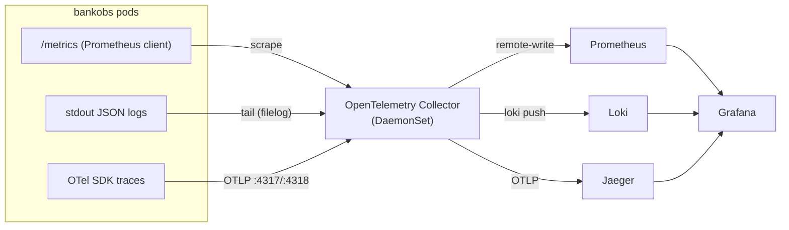

# OTEL — the three pillars, collected by OpenTelemetry

This is the **counterpart** to the parent [`student-practice`](../README.md) lab. The parent
builds metrics, logs and traces **by hand** — three separate mechanisms (Prometheus scrape,
Promtail, app→Jaeger). This module keeps the *exact same backends* (Prometheus, Loki, Jaeger) but
puts **one OpenTelemetry Collector** in the middle, so a single component collects all three
signals and fans them out.



**The honest shape:** bankobs emits OTel **traces**, but exposes a Prometheus-client `/metrics`
and writes JSON logs to stdout — it does *not* emit OTel metrics or logs. So the **Collector does
the collecting**: a `prometheus` receiver **scrapes** `/metrics`, a `filelog` receiver **tails**
pod logs, and the `otlp` receiver takes the traces. One Collector replaces Prometheus's scraper
*and* Promtail. **One wire, one place to change where any signal goes** — that is the pitch.

## Run it

Assumes the parent lab's **cluster + bankobs app are up** — and, for the Collector to find each
`/metrics`, that the app was deployed **with scrape annotations**:

```bash
# on the lab box, from ~/student-practice:
make enable-annotations-to-deploy    # so the Collector can discover each service's /metrics
make -C bankobs deploy               # (if not already) deploy the app with annotations baked in

make -C OTEL all                     # backends + remote-write + Collector + app traces
make -C OTEL observe                 # Grafana (admin/admin) + datasources + Golden/Errors dashboards
make -C OTEL traffic-bg              # steady load
make -C OTEL verify                  # Collector flowing? metric names? logs + traces landing?
make -C OTEL urls                    # UI links
```

`DRY=1 make <target>` prints each step without running it. `make -C OTEL clean` removes the
Collector and reverts the app; the backends stay.

The two incident drills (both read from the Golden Signals **Latency** panel):

```bash
make -C OTEL fault NAME=latency                          # Drill 1 — slow SERVICE (account-service is the culprit)
make -C OTEL fault NAME=latency TARGET=eligibility-engine # Drill 2 — slow DOWNSTREAM dep: loan-origination p95 spikes,
                                                         #           the trace blames eligibility-engine (fault-stop to revert)
```

## How this differs from the by-hand lab, per pillar

| Pillar | By-hand lab | This module (OTel) |
|---|---|---|
| **Metrics** | Prometheus **pulls** `/metrics` | Collector **scrapes** `/metrics` → **remote-write** to Prometheus |
| **Logs** | Promtail tails pod logs → Loki | Collector **filelog** tails pod logs → Loki |
| **Traces** | app → Jaeger direct | app → **Collector** → Jaeger |
| **Agents** | scraper + Promtail + app→Jaeger | **one** Collector |

## Two things to know

- **Metric names do NOT change.** The Collector scrapes the app's Prometheus-client `/metrics`, so
  the names stay `http_requests_total` / `http_server_requests_total` (labels `app`/`status`) and
  the **parent Golden Signals dashboards work unchanged**. (An OTel-SDK app would get semconv
  names instead.)
- **Trace→logs is by service, not trace id.** bankobs logs carry `correlation_id`, not an OTel
  `trace_id`, so the Jaeger "Trace to logs" link opens the service's logs in the span's time
  window. See [`docs/03`](docs/03-logs-with-otel.md).

Full walk-through in [`docs/`](docs/00-overview.md): 00 overview → 01 collector → 02 metrics →
03 logs → 04 traces → 05 grafana → 06 incident-drills → 07 why-this-vs-by-hand.
