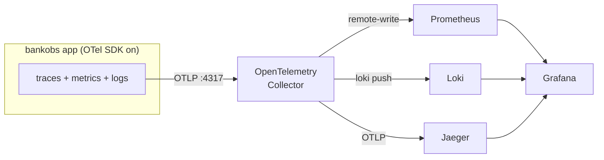
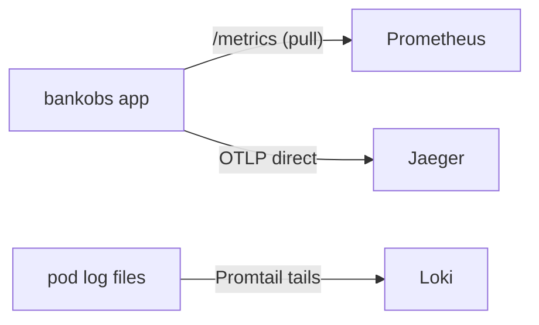

# OTEL — the three pillars, wired through OpenTelemetry

This is the **counterpart** to the parent [`student-practice`](../README.md) lab. The parent
builds metrics, logs and traces **by hand** — three separate mechanisms, no Collector. This
module keeps the *exact same backends* (Prometheus, Loki, Jaeger) but the app emits **all three
signals** through the OpenTelemetry SDK over OTLP to **one** OpenTelemetry Collector, which fans
them out.

The point of the whole module is the contrast:



Compare the by-hand lab, where the three pillars never share a wire:



**One SDK, one wire, one place to change where signals go** — that is the OpenTelemetry pitch,
and running both labs back to back is how it lands.

## Run it

Assumes the parent lab's **cluster + bankobs app are already up** (`make -C .. cluster && make -C .. app`).

```bash
make backends            # Prometheus + Loki + Jaeger  (reuses ../metrics ../logs ../traces)
make enable-remote-write # flip ONE flag so Prometheus accepts PUSHED metrics
make collector           # the OpenTelemetry Collector  (collector/values.yaml)
make app-otel            # point the app's OTLP (all 3 signals) at the Collector
# ── or all four at once ──
make all

make traffic             # generate load  (make traffic-bg to keep it running)
make verify              # collector flowing? metric names? logs + traces landing?
make urls                # UI links
```

`DRY=1 make <target>` prints each step without running it (do-it-by-hand mode), same as the
parent lab. `make clean` removes the Collector and reverts the app; the backends stay (use
`make -C .. clean` to remove them).

## How this differs from the by-hand lab, at each pillar

| Pillar | By-hand lab | This module (OTel) |
|---|---|---|
| **Metrics** | Prometheus **pulls** each pod's `/metrics` (scrape annotations) | app **pushes** via SDK → Collector → Prometheus **remote-write** |
| **Logs** | Promtail tails pod log files → Loki | app emits logs via SDK → Collector → Loki push |
| **Traces** | app sends OTLP **straight** to Jaeger | app sends OTLP to the **Collector**, which forwards to Jaeger |
| **Wiring** | three mechanisms, three configs | one SDK, one OTLP endpoint, one Collector config |

Full walk-through in [`docs/`](docs/00-overview.md) (00 overview → 01 collector → 02 app →
03 metrics → 04 logs → 05 traces → 06 why-this-vs-by-hand).

## ⚠ The metric-name gotcha (important)

With the OTel SDK the metric **names follow OpenTelemetry semconv**, not the Python client's
names. So the by-hand dashboards keyed to `http_request_duration_seconds_*` /
`http_requests_total` **may not match** what lands in Prometheus here (expect
`http_server_request_duration_seconds_*`-style names after the remote-write translation). Do
not assume — run **`make verify-metric-names`** to list the exact `__name__`s Prometheus
actually received, and point your queries/dashboards at those. This is called out in
[`docs/03-metrics-with-otel.md`](docs/03-metrics-with-otel.md).

## Needs box validation

Built from the lab's known shape, but **not yet run on a cluster** (the fresh node was in use
for the by-hand verification). Confirm on a box before relying on it:

1. **The exporters resolve and flow.** `make verify-collector` should show non-zero
   `otelcol_receiver_accepted_*` and `otelcol_exporter_sent_*`. If the `loki` or
   `prometheusremotewrite` exporter errors, check the Collector logs
   (`kubectl -n monitoring logs deploy/otel-collector`).
2. **Collector image/exporter availability.** Pinned to `otel/opentelemetry-collector-contrib:0.102.1`
   because the `loki` exporter (needed for Loki 2.9.8) was later removed from contrib. Verify
   the tag pulls and still carries both the `loki` and `prometheusremotewrite` exporters.
3. **Prometheus remote-write receiver.** `make enable-remote-write` adds
   `--web.enable-remote-write-receiver`; confirm the flag took (Prometheus `/status/flags`) and
   that pushed series appear.
4. **The real metric names** (see the gotcha above) — capture them with `make verify-metric-names`
   and update any dashboard/query you reuse from the parent lab.
5. **App OTLP endpoint reachability** — `OTEL_EXPORTER_OTLP_ENDPOINT=http://otel-collector.monitoring.svc:4317`
   from the `bankobs` namespace.
