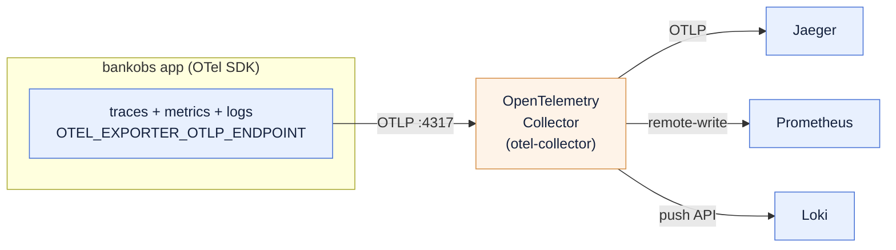

# 00 — Overview: the same three pillars, through OpenTelemetry

You already built metrics, logs and traces **by hand** in the parent lab (`../`). Each pillar
used a *different* mechanism:

| Pillar | By-hand lab (`../`) | How it got there |
|---|---|---|
| Metrics | Prometheus **scrapes** each pod's `/metrics` | you added `prometheus.io/scrape` annotations (pull) |
| Logs | **Promtail** tails the node's container logs → Loki | the app just wrote stdout |
| Traces | the **app** exports OTLP straight to Jaeger | in-app OTel SDK → Jaeger |

Three pillars, three wirings, three things to configure and keep in sync.

## What this module does instead

The app emits **all three signals** through the **OpenTelemetry SDK** over **OTLP** to **one
OpenTelemetry Collector**. The Collector fans them out to the *same* Prometheus, Loki and
Jaeger you already have.



One SDK. One wire out of the app. One place (the Collector config) that decides where each
signal goes — change a backend there and **the app never knows**.

## The build, in four steps

| Step | `make` | What happens | Doc |
|---|---|---|---|
| 1 | `backends` | Prometheus + Loki + Jaeger — the **same** ones as `../` | — |
| 2 | `enable-remote-write` | let Prometheus **accept pushed** metrics (it only pulled before) | [03](03-metrics-with-otel.md) |
| 3 | `collector` | the OpenTelemetry Collector: OTLP in → 3 backends out | [01](01-collector.md) |
| 4 | `app-otel` | point the app's OTLP (all 3 signals) at the Collector | [02](02-app-otel.md) |

Then `make traffic` and `make verify`.

```
make backends
make enable-remote-write
make collector
make app-otel
# or just: make all
make traffic
make verify
```

## Prerequisite

This module **reuses** the parent lab's cluster and the `bankobs` app. Bring those up first
(see `../README.md`): a kind cluster + `make -C .. app`. This module does **not** re-create
the cluster or re-deploy the app — it only changes how telemetry flows.

## The one thing to watch: metric names change

This is the single most important gotcha. In the by-hand lab the metrics came from the app's
**Python Prometheus client** — names like `http_requests_total` and
`http_request_duration_seconds_*`, labelled by `app`. Through the **OTel SDK** the names follow
**OpenTelemetry semantic conventions** (e.g. `http.server.request.duration` →
`http_server_request_duration_seconds_*` once Prometheus ingests it) and the service is
identified by `job`/`service_name`, **not** `app`. So the Golden Signals dashboard from `../`
will **not** light up unchanged. [docs/03](03-metrics-with-otel.md) walks through exactly how to
find the real names and fix the queries. **Do not assume the names — verify them**
(`make verify-metric-names`).

➡ Next: [01-collector.md](01-collector.md)
