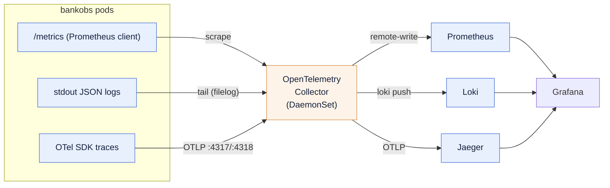

# 00 — Overview: the three pillars, collected by OpenTelemetry

In the parent lab (`../`) you built metrics, logs and traces **by hand** — three separate
mechanisms, no Collector:

| Pillar | By-hand lab (`../`) |
|---|---|
| Metrics | **Prometheus scrapes** each pod's `/metrics` (you added `prometheus.io/scrape`) |
| Logs | **Promtail** tails the node's container logs → Loki |
| Traces | the **app** exports OTLP straight to Jaeger |

This module keeps the **same backends** (Prometheus, Loki, Jaeger) but puts **one OpenTelemetry
Collector** in the middle. The Collector becomes the single thing that collects all three
signals and fans them out.

## Who emits what (the honest version)

bankobs is a real app, not a greenfield OTel demo, and that shapes the design:

- It **emits traces** through the OpenTelemetry SDK (Python and Java/Spring).
- It does **not** emit OTel metrics or OTel logs. It exposes a Prometheus-client `/metrics`
  endpoint and writes JSON logs to stdout — the same surfaces the by-hand lab consumed.

So the Collector does the **collecting** for the two pillars the app doesn't push:



**One Collector. Three receivers (`prometheus` scrape, `filelog` tail, `otlp`). Three
exporters.** It replaces *both* Prometheus's own scraper *and* Promtail. That single point of
collection — change a backend in one config and nothing else moves — is the OpenTelemetry pitch,
and running this lab next to the by-hand one is how it lands.

> **Metric names do NOT change here.** Because the Collector scrapes the app's existing
> Prometheus-client `/metrics`, the names stay `http_requests_total` /
> `http_server_requests_total` with `app` / `status` labels — so the parent's Golden Signals
> dashboards work unchanged. (That is different from an app that emits OTel-SDK metrics, where
> the names would follow semconv.)

## The build, end to end

Everything below is runnable top to bottom. First-time image pulls dominate the wall clock.

```bash
# ── On your workstation / control box (needs terraform + AWS creds) ──
make tf-apply                       # provision an EC2 box + an empty kind cluster
terraform output -raw public_ip     # the lab box's public IP

# ── SSH into the lab box (user: ec2-user, password: DevOps321), then: ──
cd ~/student-practice
make enable-annotations-to-deploy   # mark every service's /metrics so the Collector can find it
make -C bankobs deploy              # deploy the 75-service app   (first run pulls images ~30–40 min)
make -C bankobs wait                # block until the datastores are Ready + seeded

make -C OTEL all                    # backends (Prom+Loki+Jaeger) + remote-write + Collector + app traces
make -C OTEL observe                # Grafana (admin/admin) + datasources + Golden Signals / Errors dashboards
make -C OTEL traffic-bg             # steady background load so the dashboards have data
make -C OTEL urls                   # the UI links (Grafana :3000, Prometheus :9090, Jaeger :16686)

make -C OTEL verify                 # sanity: Collector flowing? metric names? logs + traces landing?
```

| Step | What happens | Doc |
|---|---|---|
| `make -C OTEL all` | `backends` → `enable-remote-write` → `collector` → `app-otel` | [01](01-collector.md) |
| `make -C OTEL observe` | Grafana + datasources + dashboards | [05](05-grafana.md) |
| the two drills | a slow service, and a slow downstream dependency | [06](06-incident-drills.md) |

### Why the annotations step
`make enable-annotations-to-deploy` opts every service into scraping by adding
`prometheus.io/scrape|path|port` to its pod. The Collector's `prometheus` receiver reads those
annotations to know **where** each `/metrics` is. Run it **before** `make -C bankobs deploy` so
the annotations are baked into the one deploy (no re-roll). See [02](02-metrics-with-otel.md).

## Prerequisite recap

- A kind cluster + the `bankobs` app, both on the lab box (`make tf-apply` gives you the
  cluster; `make -C bankobs deploy` gives you the app).
- This module does **not** re-create the cluster or re-deploy the app — it changes *how*
  telemetry is collected.

➡ Next: [01-collector.md](01-collector.md)
