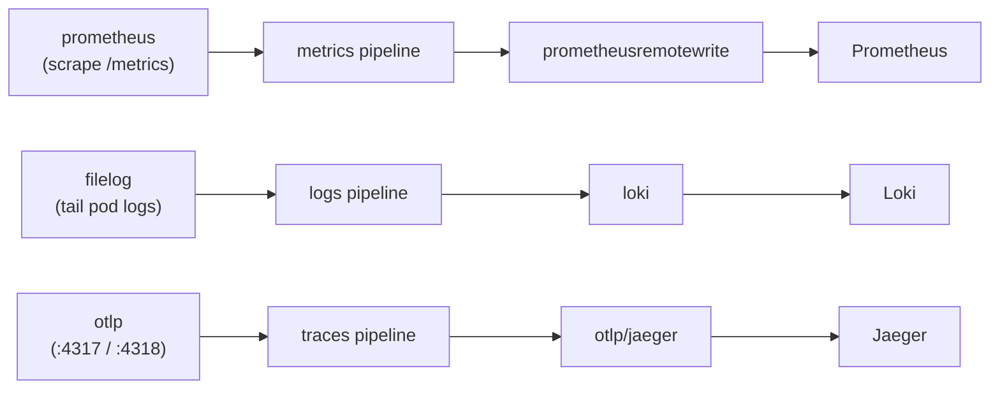

# 01 — The OpenTelemetry Collector (the one new moving part)

The Collector is the whole difference between this module and the by-hand lab. It is **one
component** that collects all three signals and forwards them to the backends you already know.

## Shape: a DaemonSet node-agent

```yaml
mode: daemonset          # one agent per node
command: { name: otelcol-contrib }
image: { repository: otel/opentelemetry-collector-contrib, tag: "0.102.1" }
```

Why a DaemonSet and not a single Deployment? The **`filelog`** receiver reads **node-local** pod
log files (`/var/log/pods/...`), so the Collector has to run on every node. This kind cluster has
one node, so that is one pod — but the shape is what matters. The app still reaches it through a
normal Service (`otel-collector`, ports `:4317`/`:4318`) for OTLP traces.

## Three receivers → three exporters

See [`collector/values.yaml`](../collector/values.yaml). In one picture:



| Pillar | Receiver | How it collects | Exporter | Doc |
|---|---|---|---|---|
| Metrics | `prometheus` | scrapes each bankobs `/metrics` (annotation discovery) | `prometheusremotewrite` | [02](02-metrics-with-otel.md) |
| Logs | `filelog` | tails `/var/log/pods` (the `logsCollection` preset) | `loki` | [03](03-logs-with-otel.md) |
| Traces | `otlp` | receives spans the app's SDK pushes | `otlp/jaeger` | [04](04-traces-with-otel.md) |

The `kubernetesAttributes` + `logsCollection` presets add the `k8sattributes` processor, the
`filelog` receiver, and the RBAC/host mounts they need; the rest of the pipeline is spelled out
in the values file.

## The one gotcha: pin the chart to the image

The chart is pinned in the Makefile:

```make
OTEL_CHART_VER ?= 0.93.3     # appVersion 0.102.1, matches the pinned image
```

If you let the chart float, a newer chart **auto-renames** the `otlp` exporter to `otlp_grpc`,
which the pinned `0.102.1` binary does not recognise — the Collector then crashloops with
`unknown type: "otlp_grpc"`. Chart `0.93.3` ships appVersion `0.102.1` and predates that rename.
(The image is pinned because the `loki` exporter we need for Loki 2.9.8 was later removed from
contrib — see [03](03-logs-with-otel.md).)

## Install it

```bash
make -C OTEL collector      # helm upgrade --install, pinned chart, then rollout status
```

## Watch what it is doing

```bash
kubectl -n monitoring logs -f daemonset/otel-collector-agent   # the DaemonSet is "-agent"
make -C OTEL verify-collector                                  # accepted/exported counters
```

`verify-collector` prints the Collector's own telemetry — non-zero `otelcol_receiver_accepted_*`
and `otelcol_exporter_sent_*` mean signals are flowing in and out.

➡ Next: [02-metrics-with-otel.md](02-metrics-with-otel.md)
