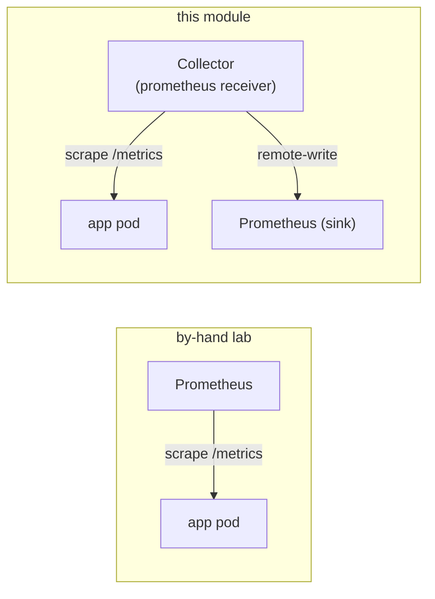

# 02 — Metrics: the Collector scrapes, Prometheus stores

In the by-hand lab **Prometheus pulled** each pod's `/metrics` directly. Here the **Collector**
pulls them and **pushes** them on to Prometheus. Prometheus stops scraping the app and becomes a
pure storage sink.



## The app still exposes Prometheus-client metrics

bankobs does **not** emit OTel metrics — it exposes a plain Prometheus `/metrics`. The Collector's
`prometheus` receiver scrapes it with the **same annotation discovery** the by-hand Prometheus
used (see [`collector/values.yaml`](../collector/values.yaml)): keep pods in namespace `bankobs`
with `prometheus.io/scrape=true`, read `prometheus.io/path` + `prometheus.io/port`, and relabel
`app` / `namespace` / `pod` onto every series.

That is why you run **`make enable-annotations-to-deploy` before `make -C bankobs deploy`**: the
annotations tell the Collector *where* each service's `/metrics` lives. Without them the Collector
has nothing to scrape.

## Prometheus becomes a sink (no double collection)

`make -C OTEL enable-remote-write` applies
[`collector/prometheus-rw.values.yaml`](../collector/prometheus-rw.values.yaml), which does two
things:

```yaml
server:
  extraFlags: [ web.enable-lifecycle, web.enable-remote-write-receiver ]  # accept pushes
scrapeConfigs:
  bankobs-pods: { enabled: false }     # stop Prometheus scraping the app — the Collector does it now
```

If you left Prometheus scraping *and* the Collector scraping, every series would arrive twice.
Turning the pull job off makes the Collector the single collector. Confirm:

```bash
# Prometheus should show only its own 'prometheus' self-job, NOT 'bankobs-pods':
kubectl -n monitoring exec deploy/prometheus-server -c prometheus-server -- \
  wget -qO- localhost:9090/api/v1/targets | grep -o '"job":"[^"]*"' | sort -u
```

## The names do NOT change — and that is the point

Because the source is the app's Prometheus client (not an OTel SDK), the names are exactly what
the by-hand lab saw:

```bash
make -C OTEL verify-metric-names
```

expect `http_requests_total` (Python services), `http_server_requests_total` (Java/Spring), the
`*_request_duration_seconds_bucket` histograms, `process_*`, and `up` — all with `app`, `status`,
`handler`, `namespace="bankobs"` labels. So the **parent Golden Signals + Errors dashboards work
unchanged** ([05](05-grafana.md)). The trade-off an OTel-SDK app would make — standardised
semconv names, but different from your old ones — simply doesn't arise when the Collector scrapes
existing Prometheus metrics.

➡ Next: [03-logs-with-otel.md](03-logs-with-otel.md)
