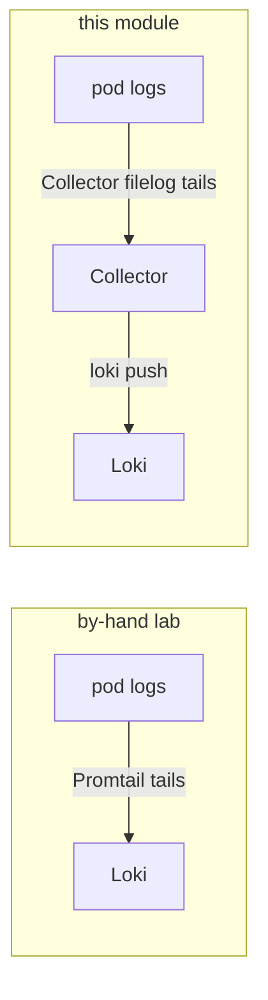

# 03 — Logs: the Collector tails them (Promtail is gone)

In the by-hand lab **Promtail** (a separate DaemonSet) tailed the node's container logs and
pushed them to Loki. Here the **Collector's `filelog` receiver** does exactly that job, so there
is no Promtail — one fewer agent to run.



The `logsCollection` preset (in [`collector/values.yaml`](../collector/values.yaml)) adds the
`filelog` receiver and the `/var/log/pods` host mounts it needs. Loki is installed **without**
Promtail (`--set promtail.enabled=false` in the `backends` step).

## Why the `loki` exporter (and the pinned image)

Loki here is 2.9.8, which has no native OTLP ingest (that is Loki 3.x). The contrib **`loki`**
exporter speaks Loki's own push protocol — but it was later *removed* from the collector-contrib
image, which is why the image is pinned to `0.102.1` (the last version that still ships it). On
Loki 3.x you would drop the `loki` exporter for a plain `otlphttp` to `http://loki:3100/otlp`.

## Stream labels

Loki rejects a push with no labels. The filelog `container` operator parses
`k8s.namespace.name` / `k8s.container.name` / `k8s.pod.name` off each log file's path, and the
`loki.resource.labels` hint (set in the `resource` processor) promotes them to Loki stream
labels. So you can select a service's logs by its name:

```bash
make -C OTEL verify-logs       # lists the stream labels Loki has seen
# in Grafana Explore (loki):
{k8s_container_name="account-service"}
```

`k8s_container_name` is the service name — the label you narrow to when the trace→logs drill
lands empty ([05](05-grafana.md)).

## The correlation reality: by trace id, but only partially

Trace↔logs here is wired **by trace id** (same as the by-hand lab) — and that works, *for the
services that actually log a trace id*. The honest, verified picture:

- **Journey-tier services** (`loan-origination`, `notification-orchestrator`, `remittance-service`)
  log an OpenTelemetry **`trace_id`** that matches the one in Jaeger → a span's "Related logs" button
  lands on that **exact request's** log lines, and a log's `trace_id` links back to its trace.
- **The Go tier** (`gateway-service`, `payment-gateway`) has no in-code OTel and **no Beyla in this
  module**, so it emits **no spans at all** — nothing to correlate (its logs carry their own
  `trace_id`/`correlation_id` that Jaeger never sees).
- **Most other services** don't log a trace id, so trace→logs comes back empty — there you drop the
  `|= "<id>"` filter and narrow by `{k8s_container_name="<service>"}`.

The key lesson: **the Collector forwards the app's existing logs — it does not inject the trace id
into them.** Correlation quality depends on what the app writes, not on adding a collector. Full
one-click-everywhere correlation needs the app itself to use an OTel log appender that stamps the
trace id into every line (bankobs doesn't) — [05](05-grafana.md) shows the drill and that caveat.

➡ Next: [04-traces-with-otel.md](04-traces-with-otel.md)
