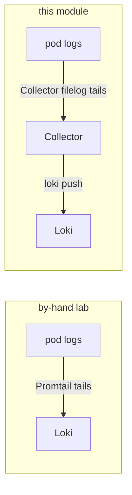

# 03 — Logs: the Collector tails them (Promtail is gone)

In the by-hand lab **Promtail** (a separate DaemonSet) tailed the node's container logs and
pushed them to Loki. Here the **Collector's `filelog` receiver** does exactly that job, so there
is no Promtail — one fewer agent to run.



The `logsCollection` preset (in [`collector/values.yaml`](../collector/values.yaml)) adds the
`filelog` receiver and the `/var/log/pods` host mounts it needs. Loki is installed **without**
Promtail (`--set promtail.enabled=false` in the `backends` step).

## Why the `loki` exporter (and the pinned image)

Loki here is 2.9.8, which has no native OTLP ingest (that is Loki 3.x). The contrib **`loki`**
exporter speaks Loki's own push protocol — but it was later *removed* from the collector-contrib
image, which is why the image is pinned to `0.102.1` (the last version that still ships it). On
Loki 3.x you would drop the `loki` exporter for a plain `otlphttp` to `http://loki:3100/otlp`.

## Stream labels

Loki rejects a push with no labels. The filelog `container` operator parses
`k8s.namespace.name` / `k8s.container.name` / `k8s.pod.name` off each log file's path, and the
`loki.resource.labels` hint (set in the `resource` processor) promotes them to Loki stream
labels. So you can select a service's logs by its name:

```bash
make -C OTEL verify-logs       # lists the stream labels Loki has seen
# in Grafana Explore (loki):
{k8s_container_name="account-service"}
```

`k8s_container_name` is the service name — the label the trace→logs drill uses ([05](05-grafana.md)).

## The correlation reality: `correlation_id`, not `trace_id`

bankobs's JSON logs carry a **`correlation_id`** (a per-request id), **not** an OpenTelemetry
`trace_id`. So you **cannot** join a trace to its logs by trace id here. Two consequences, both
designed around in [05](05-grafana.md):

- **Trace → logs** is wired **by service + time window** (open the service's logs around the
  span's time), not by trace id.
- A Loki **derived field** surfaces `correlation_id` so you can pivot from one log line to every
  other line of the same request.

This is the honest situation for an app whose logging predates trace-context injection — and it
is a good lesson: the Collector collects the logs happily, but *correlation quality* depends on
what the app actually writes.

➡ Next: [04-traces-with-otel.md](04-traces-with-otel.md)
