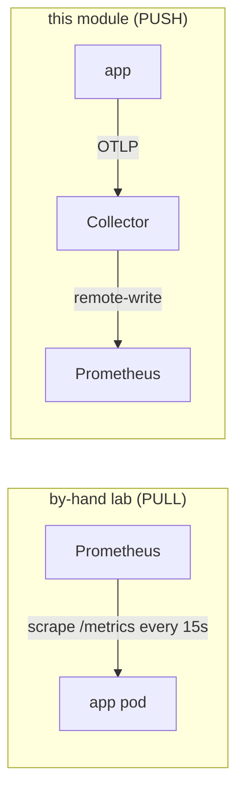

# 03 — Metrics with OTel: push, and different names

This is the pillar that changes the most between the two labs — in **two** ways. Read it
carefully; it's where the "why OTel" and "watch out" lessons both live.

## Change 1 — pull becomes push



In the by-hand lab **Prometheus reached into each pod and pulled** `/metrics` (you added the
`prometheus.io/scrape` annotation). Here the app **pushes** metrics (OTLP → Collector), and the
Collector **pushes** them on to Prometheus via **remote-write**.

Prometheus refuses remote-write unless it was started with the receiver flag — that's the whole
reason for step 2:

```bash
make enable-remote-write
```

which re-applies the parent's Prometheus values **plus**
[`collector/prometheus-rw.values.yaml`](../collector/prometheus-rw.values.yaml):

```yaml
server:
  extraFlags:
    - web.enable-lifecycle
    - web.enable-remote-write-receiver   # <- the Collector pushes to /api/v1/write
```

> **Why keep remote-write and the pull job both on?** You don't have to. If you leave the
> parent lab's `prometheus.io/scrape` annotations on, Prometheus will *also* pull `/metrics` —
> so the same request data arrives twice, under two different names. For a clean comparison,
> turn scraping off first: `make -C .. disable-annotations-to-deploy && make -C .. app`, then
> `make app-otel`.

## Change 2 — the metric NAMES are different (the big gotcha)

The by-hand metrics came from the app's **Python Prometheus client**. Through the **OTel SDK**
they follow **OpenTelemetry semantic conventions**. So your queries and the Golden Signals
dashboard from `../` **will not work unchanged**.

Likely before → after (⚠ **verify on the box — do not trust this table blindly**):

| By-hand (Python client) | OTel semconv (after Prometheus ingest) |
|---|---|
| `http_requests_total` (counter) | *no direct equivalent* — derive rate from the histogram's `_count` |
| `http_request_duration_seconds_bucket` | `http_server_request_duration_seconds_bucket` |
| label `app="upi-service"` | label `job="upi-service"` / `service_name="upi-service"` |
| `process_cpu_seconds_total` | `process.runtime.*` / target `up` — may differ by language |

Why it shifts:
- OTel metric **names** use dotted semconv (`http.server.request.duration`); the
  `prometheusremotewrite` exporter translates dots to underscores and appends the unit
  (`_seconds`), giving `http_server_request_duration_seconds_*`.
- OTel identifies a service by the **resource attribute** `service.name`, which remote-write
  maps to the Prometheus `job` label (and `target_info`), **not** the `app` pod label the
  by-hand relabel rules set.

### Find the real names — don't guess

```bash
make verify-metric-names
```

lists every Prometheus metric name containing `http`/`request`. Or by hand:

```bash
kubectl -n monitoring port-forward svc/prometheus-server 9090:80 &
curl -s 'http://localhost:9090/api/v1/label/__name__/values' | jq -r '.data[]' | grep -Ei 'http|request'
# and the labels on one of them:
curl -s 'http://localhost:9090/api/v1/series?match[]=http_server_request_duration_seconds_count' | jq '.data[0]'
```

You can also read them straight off the Collector's debug log
(`kubectl -n monitoring logs deploy/otel-collector`) — it prints the metric names it exports.

### Then fix the queries

Once you know the real names, the Golden Signals translate roughly like this (adjust to what
`verify-metric-names` actually shows):

```promql
# Latency p95
histogram_quantile(0.95,
  sum by (le) (rate(http_server_request_duration_seconds_bucket{job=~"$service"}[$__rate_interval])))

# Traffic (req/s) — from the histogram count, since there's no *_total counter
sum by (job) (rate(http_server_request_duration_seconds_count{job=~"$service"}[$__rate_interval]))
```

Group by **`job`** (or `service_name`), not `app`. If you want to reuse the `../grafana`
dashboards, copy them into this module and swap the metric names + the `$service` variable's
`label_values(...)` from `app` to `job`.

## See it work

```bash
make traffic
make verify-metric-names     # the OTel names appear
make verify-collector        # otelcol_exporter_sent_metric_points climbing
```

> **This lab's teaching point:** OTel gives you **vendor-neutral, standardised** metric names
> (`http.server.request.duration` means the same thing across every OTel app and backend) — but
> "standardised" also means "different from your old Python-client names," so dashboards built
> against the old names must be migrated. That tradeoff *is* the lesson.

➡ Next: [04-logs-with-otel.md](04-logs-with-otel.md)
