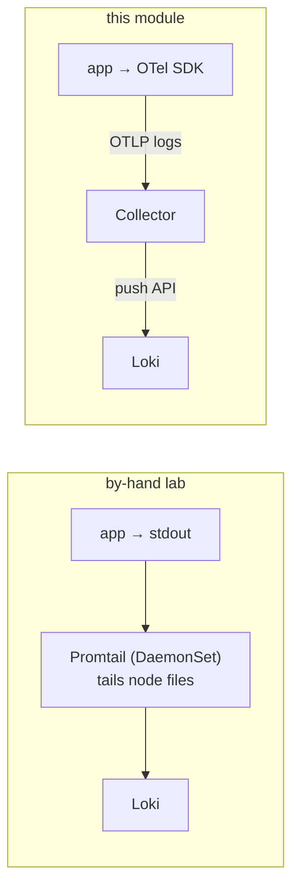

# 04 — Logs with OTel: the app ships them, not a tailer

## The one idea

In the by-hand lab the app knew **nothing** about logging to Loki — it wrote JSON to stdout and
**Promtail** (a DaemonSet on the node) tailed the container files and pushed them to Loki. Here
the app's **OTel SDK emits log records over OTLP** to the Collector, which forwards them to Loki.
No node-level tailer in the path.



## The concrete values

The Collector's log pipeline ([`collector/values.yaml`](../collector/values.yaml)):

```yaml
exporters:
  loki:
    endpoint: http://loki.monitoring.svc:3100/loki/api/v1/push
service:
  pipelines:
    logs:
      receivers:  [otlp]
      processors: [memory_limiter, resource, batch]
      exporters:  [loki, debug]
```

### Why the `loki` exporter (and not plain OTLP)?

The cleanest modern path is OTLP straight into Loki's native OTLP endpoint
(`/otlp/v1/logs`) — but that only exists in **Loki 3.x**. This lab reuses the parent's **Loki
2.9.8**, which has no OTLP ingest, so the Collector uses the contrib **`loki` exporter**, which
speaks Loki's own push protocol (`/loki/api/v1/push`).

Two consequences worth knowing:

- The `loki` exporter is **deprecated** in newer collector builds (and removed in the latest),
  which is why [`collector/values.yaml`](../collector/values.yaml) pins the contrib image to
  `0.102.1`.
- **If you move to Loki 3.x**, delete the `loki` exporter and use:
  ```yaml
  exporters:
    otlphttp/loki:
      endpoint: http://loki.monitoring.svc:3100/otlp
  ```
  then you can also un-pin the collector image. This is the recommended setup going forward.

## Labels: don't expect the same ones

The by-hand Promtail path labelled streams with `namespace`, `pod`, `app`, `container`
(Kubernetes metadata it read off the node). The OTLP→`loki` path derives labels from **OTel
resource/log attributes**, so you'll typically see `service_name`, `level`, maybe `exporter`,
and **not** the pod-centric labels. Query with what's actually there:

```bash
make verify-logs    # lists the stream labels Loki actually has
```

then in Grafana Explore (loki datasource) use those labels, e.g. `{service_name="upi-service"}`
instead of the by-hand `{app="upi-service"}`.

## The steps + see it work

Logs start flowing the moment the app points at the Collector (`make app-otel`) — there's no
separate install for this pillar.

```bash
make traffic
make verify-logs                                   # service labels appear in Loki
kubectl -n monitoring logs deploy/otel-collector   # debug exporter shows log batches
```

## The contrast, in one line

By-hand logs needed **no app change** but a **node-level agent** (Promtail). OTel logs need **no
node agent** but **do** need the app instrumented. Same destination (Loki), opposite side of
the app boundary.

➡ Next: [05-traces-with-otel.md](05-traces-with-otel.md)
