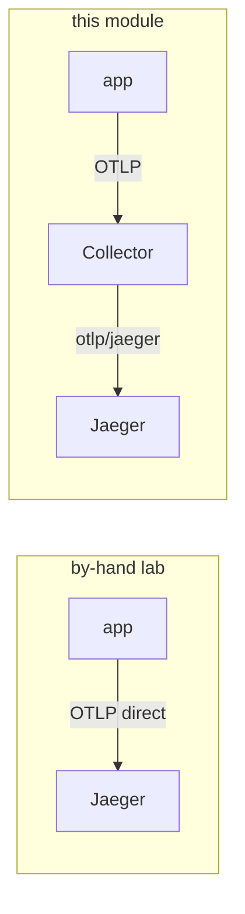

# 04 — Traces: the app emits, the Collector forwards

Traces are the pillar the app emits itself — **every tier** is OpenTelemetry-instrumented in code
(Python SDK, Java/Spring, and the Go payment services via a shared Go SDK). The main change from the
by-hand lab is **one hop**: the app sends OTLP to the **Collector** instead of straight to Jaeger, and
the Collector forwards to Jaeger.



Why route through the Collector at all, when the app can reach Jaeger directly? So that **one
place** decides where traces go — add tail-sampling, swap Jaeger for Tempo, or fan out to a
second backend, all in the Collector config, with **no app change**. That is the same single
point of control the metrics and logs pillars now get.

## What `make traces` sets

`make -C OTEL traces` turns on every tier's in-app tracing and points it at the Collector (this does
**not** touch metrics or logs — the Collector collects those):

```bash
kubectl -n bankobs set env deployment -l domain \
  OTEL_SDK_DISABLED=false \
  OTEL_TRACES_EXPORTER=otlp OTEL_METRICS_EXPORTER=none OTEL_LOGS_EXPORTER=none \
  OTEL_EXPORTER_OTLP_PROTOCOL=grpc \
  OTEL_EXPORTER_OTLP_ENDPOINT=http://otel-collector.monitoring.svc:4317 \
  MANAGEMENT_TRACING_ENABLED=true \
  MANAGEMENT_OTLP_TRACING_ENDPOINT=http://otel-collector.monitoring.svc:4318/v1/traces \
  MANAGEMENT_TRACING_SAMPLING_PROBABILITY=1.0
```

- **Python** services export OTLP/gRPC to the Collector on **:4317**.
- **Java/Spring** services export OTLP/HTTP to the Collector on **:4318**
  (`MANAGEMENT_OTLP_TRACING_ENDPOINT`), at 100% sampling.
- **The Go payment tier** (`gateway-service`, `payment-gateway`, `upi-service`) uses a **shared Go
  OTel SDK** and exports OTLP/gRPC to the Collector on **:4317** too — but it gates the exporter behind
  its own flag, `OBSERVABILITY_MODE`, which `make enable-annotations-to-deploy` sets to `full`. (Until
  then it creates spans but doesn't export them.) It's a real OpenTelemetry SDK compiled into the
  service — which is why its spans carry the same `trace_id` it writes into its logs.

`OTEL_METRICS_EXPORTER=none` / `OTEL_LOGS_EXPORTER=none` are deliberate: the app has no useful
OTel metrics or logs to push, so we leave those off and let the Collector scrape/tail instead.

## Verify

```bash
make -C OTEL verify-traces       # the services Jaeger has seen
```

Expect ~46 services — including `gateway-service`, `payment-gateway` and `upi-service` (the Go tier,
as real SDK spans). Open Jaeger (`make -C OTEL urls`), search `payment-gateway`, and the payment
waterfall spans the Go hops too — all arriving via the Collector.

> **Heads-up for the drills:** traces here are HTTP server + client spans across services (e.g.
> `loan-origination` → `eligibility-engine`). That cross-service linking is exactly what Drill 2
> relies on — a slow downstream dependency shows up as a long **call span** in the caller's trace,
> even though the dependency's own `/metrics` looks healthy. There are no JDBC/DB child spans (the
> app doesn't instrument the database layer). See [06](06-incident-drills.md).

➡ Next: [05-grafana.md](05-grafana.md)
