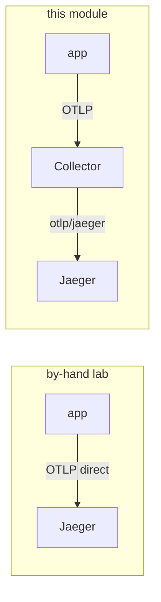

# 04 — Traces: the app emits, the Collector forwards

Traces are the one pillar the app emits itself — it is already OpenTelemetry-instrumented. The
only change from the by-hand lab is **one hop**: the app sends OTLP to the **Collector** instead
of straight to Jaeger, and the Collector forwards to Jaeger.



Why route through the Collector at all, when the app can reach Jaeger directly? So that **one
place** decides where traces go — add tail-sampling, swap Jaeger for Tempo, or fan out to a
second backend, all in the Collector config, with **no app change**. That is the same single
point of control the metrics and logs pillars now get.

## What `app-otel` sets

`make -C OTEL app-otel` points the app's SDK at the Collector (it does **not** touch metrics or
logs — the Collector collects those):

```bash
kubectl -n bankobs set env deployment -l domain \
  OTEL_SDK_DISABLED=false \
  OTEL_TRACES_EXPORTER=otlp OTEL_METRICS_EXPORTER=none OTEL_LOGS_EXPORTER=none \
  OTEL_EXPORTER_OTLP_PROTOCOL=grpc \
  OTEL_EXPORTER_OTLP_ENDPOINT=http://otel-collector.monitoring.svc:4317 \
  MANAGEMENT_TRACING_ENABLED=true \
  MANAGEMENT_OTLP_TRACING_ENDPOINT=http://otel-collector.monitoring.svc:4318/v1/traces \
  MANAGEMENT_TRACING_SAMPLING_PROBABILITY=1.0
```

- **Python** services export OTLP/gRPC to the Collector on **:4317**.
- **Java/Spring** services export OTLP/HTTP to the Collector on **:4318**
  (`MANAGEMENT_OTLP_TRACING_ENDPOINT`), at 100% sampling.

`OTEL_METRICS_EXPORTER=none` / `OTEL_LOGS_EXPORTER=none` are deliberate: the app has no useful
OTel metrics or logs to push, so we leave those off and let the Collector scrape/tail instead.

## Verify

```bash
make -C OTEL verify-traces       # the services Jaeger has seen
```

Expect dozens of services. Open Jaeger (`make -C OTEL urls`) and search one — you'll see the same
spans as the by-hand lab, just arriving via the Collector.

> **Heads-up for the drills:** traces here are HTTP server + client spans across services (e.g.
> `loan-origination` → `eligibility-engine`). That cross-service linking is exactly what Drill 2
> relies on — a slow downstream dependency shows up as a long **call span** in the caller's trace,
> even though the dependency's own `/metrics` looks healthy. There are no JDBC/DB child spans (the
> app doesn't instrument the database layer). See [06](06-incident-drills.md).

➡ Next: [05-grafana.md](05-grafana.md)
