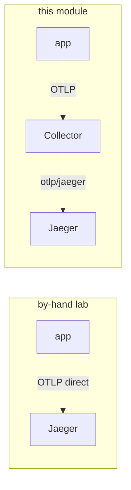

# 04 — Traces: the app emits, the Collector forwards

Traces are the pillar the app emits itself — the Python and Java tiers are already
OpenTelemetry-instrumented. The main change from the by-hand lab is **one hop**: the app sends OTLP
to the **Collector** instead of straight to Jaeger, and the Collector forwards to Jaeger. (The one
tier the app *can't* trace on its own — the Go payment services — is covered by Beyla eBPF, below.)



Why route through the Collector at all, when the app can reach Jaeger directly? So that **one
place** decides where traces go — add tail-sampling, swap Jaeger for Tempo, or fan out to a
second backend, all in the Collector config, with **no app change**. That is the same single
point of control the metrics and logs pillars now get.

## What `make traces` sets

`make -C OTEL traces` does two things — turn on the app's own SDK traces, and deploy **Beyla** for
the Go tier that has no SDK. **Three ways to a span, all landing on the Collector.**

**1) The app's SDK** (Python + Java). Point it at the Collector (this does **not** touch metrics or
logs — the Collector collects those):

```bash
kubectl -n bankobs set env deployment -l domain \
  OTEL_SDK_DISABLED=false \
  OTEL_TRACES_EXPORTER=otlp OTEL_METRICS_EXPORTER=none OTEL_LOGS_EXPORTER=none \
  OTEL_EXPORTER_OTLP_PROTOCOL=grpc \
  OTEL_EXPORTER_OTLP_ENDPOINT=http://otel-collector.monitoring.svc:4317 \
  MANAGEMENT_TRACING_ENABLED=true \
  MANAGEMENT_OTLP_TRACING_ENDPOINT=http://otel-collector.monitoring.svc:4318/v1/traces \
  MANAGEMENT_TRACING_SAMPLING_PROBABILITY=1.0
```

- **Python** services export OTLP/gRPC to the Collector on **:4317**.
- **Java/Spring** services export OTLP/HTTP to the Collector on **:4318**
  (`MANAGEMENT_OTLP_TRACING_ENDPOINT`), at 100% sampling.

`OTEL_METRICS_EXPORTER=none` / `OTEL_LOGS_EXPORTER=none` are deliberate: the app has no useful
OTel metrics or logs to push, so we leave those off and let the Collector scrape/tail instead.

**2) Beyla (eBPF) for the Go payment tier.** `gateway-service`, `payment-gateway` and `upi-service`
are Go binaries with **no OpenTelemetry compiled in** — the `OTEL_*` env above is set on them but
does nothing, so they emit **no spans**, and a payment trace would have holes exactly at those hops.
Beyla attaches to the Go binaries in the kernel via eBPF and produces OTLP traces with no code
change, exporting to the **Collector** (not straight to Jaeger — same one-hop-through-the-Collector
shape as the SDK):

```bash
kubectl apply -f traces/beyla.yaml      # DaemonSet, scoped to ports 8000/8010/8011
```

`traces/beyla.yaml` is a privileged, `hostPID` DaemonSet scoped by listening port so it instruments
**only** the three Go services (it won't double-trace the Python/Java tiers). It needs a kernel
≥ 5.8 with BTF — the kind node (RHEL 9) has it. Without this step, `verify-traces` is missing the Go
tier; with it, the Go hops appear and payment traces are complete.

## Verify

```bash
make -C OTEL verify-traces       # the services Jaeger has seen
```

Expect ~46 services — including `gateway-service`, `payment-gateway` and `upi-service` (the Go tier,
via Beyla). Open Jaeger (`make -C OTEL urls`), search `payment-gateway`, and the payment waterfall now
spans the Go hops too — all arriving via the Collector.

> **Heads-up for the drills:** traces here are HTTP server + client spans across services (e.g.
> `loan-origination` → `eligibility-engine`). That cross-service linking is exactly what Drill 2
> relies on — a slow downstream dependency shows up as a long **call span** in the caller's trace,
> even though the dependency's own `/metrics` looks healthy. There are no JDBC/DB child spans (the
> app doesn't instrument the database layer). See [06](06-incident-drills.md).

➡ Next: [05-grafana.md](05-grafana.md)
