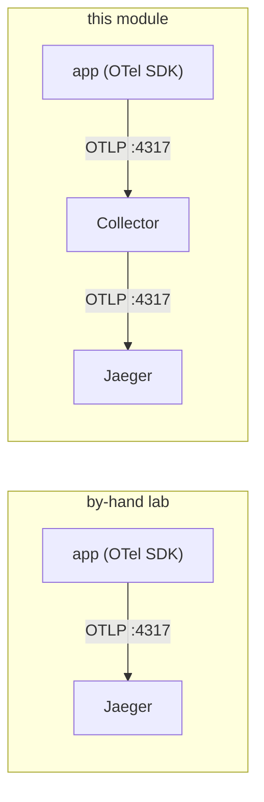

# 05 — Traces with OTel: one hop further than the by-hand lab

## The one idea

Traces are the pillar that was **already** OTel in the by-hand lab — the app spoke OTLP to
Jaeger directly. The only change here is **where the OTLP goes**: to the **Collector** instead
of straight to Jaeger. The Collector then forwards to the same Jaeger.



That one extra hop looks pointless for a single backend — but it's the reason the pattern
scales: the Collector can **batch**, **sample**, **redact** and **fan out** traces to several
backends at once, all without touching the app.

## The concrete values

The Collector's trace pipeline ([`collector/values.yaml`](../collector/values.yaml)):

```yaml
exporters:
  otlp/jaeger:
    endpoint: jaeger-collector.monitoring.svc:4317   # same Jaeger the by-hand lab used
    tls: { insecure: true }
service:
  pipelines:
    traces:
      receivers:  [otlp]
      processors: [memory_limiter, resource, batch]
      exporters:  [otlp/jaeger, debug]
```

And the app side (set by `make app-otel`, [docs/02](02-app-otel.md)) points OTLP at the
**Collector**, not Jaeger:

```
OTEL_EXPORTER_OTLP_ENDPOINT=http://otel-collector.monitoring.svc:4317
```

## The steps + see it work

```bash
make traffic
make verify-traces     # services reporting traces to Jaeger (via the Collector)
make urls              # open the Jaeger UI
```

In Jaeger, pick a service (e.g. `upi-service`) → **Find traces** → open a multi-span trace. It
looks identical to the by-hand lab's traces — because it's the same SDK and the same Jaeger. The
difference is entirely in the path the spans took to get there.

## Why route traces through the Collector at all?

For this single-Jaeger lab you wouldn't bother. In the real world you do, because the Collector
lets you, with **zero app changes**:

- **tail-sample** (keep the slow/errored traces, drop the boring 99%),
- **add or scrub attributes** centrally (e.g. strip PII from span tags),
- **fan out** to more than one tracing backend during a migration,
- **decouple** the app from the backend's availability (the Collector buffers).

That's the same argument as metrics and logs: **one place to change, the app stays put.**

## Full-picture payoff

With traces, metrics and logs all flowing through the one Collector, you have the exact same
three-pillar investigation story as the parent lab (metrics → traces → logs; see
`../docs/05-grafana.md`) — only now every signal shares one pipeline and one set of resource
attributes, which makes correlation (same `service.name`, same `trace_id`) more consistent.

➡ Next: [06-why-this-vs-byhand.md](06-why-this-vs-byhand.md)
