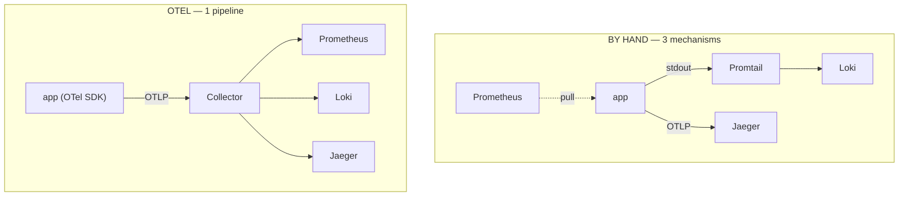

# 06 — Why OTel: the two labs, side by side

You've now built the three pillars **twice** — by hand (`../`) and through OpenTelemetry (here).
This is the synthesis.

## The whole difference, in one table

| | By-hand lab (`../`) | OTel module (this) |
|---|---|---|
| **Metrics** | Prometheus **pulls** `/metrics` (scrape annotations) | app **pushes** OTLP → Collector → remote-write |
| **Logs** | **Promtail** tails node files → Loki | app **emits** OTLP logs → Collector → Loki |
| **Traces** | app → OTLP → Jaeger directly | app → OTLP → **Collector** → Jaeger |
| **App config** | annotation + stdout + trace endpoint (3 things) | **one** `OTEL_EXPORTER_OTLP_ENDPOINT` |
| **Where "where to send" lives** | spread across annotations, a DaemonSet, an env var | **one** Collector config |
| **Swap a backend** | reconfigure that pillar's mechanism | edit one exporter, app untouched |
| **Metric names** | your Python-client names (`http_requests_total`, label `app`) | OTel **semconv** names (`http_server_request_duration_seconds_*`, label `job`) |
| **Moving parts** | 3 independent wirings | 1 SDK + 1 Collector |

## What OTel actually buys you

1. **One instrumentation, many backends.** The app emits standard OTLP. Where it lands is a
   Collector decision, not an app decision. Switching vendors (or running two during a
   migration) is an exporter edit, not a redeploy.
2. **A single control point.** Batching, memory limits, sampling, attribute scrubbing, routing —
   all configured once, in the Collector, for every service at once.
3. **Vendor-neutral, standardised semantics.** `http.server.request.duration` means the same
   thing everywhere. Dashboards and alerts become portable across apps and backends.
4. **Decoupling.** The app doesn't need to reach, authenticate to, or stay in sync with each
   backend. It reaches one local Collector.

## What it costs you (be honest)

1. **The names change.** Standardised means *different* from your old Python-client names — the
   by-hand Golden Signals dashboard needs its queries migrated (`app` → `job`,
   `http_request_duration_seconds_*` → `http_server_request_duration_seconds_*`). See
   [docs/03](03-metrics-with-otel.md).
2. **A new component to run.** The Collector is one more thing to deploy, size and watch.
3. **Instrumentation must actually emit each signal.** "OTLP for everything" is only as true as
   the SDK wiring in each service (see [docs/02](02-app-otel.md) caveat).
4. **Version/compat edges.** e.g. the `loki` exporter vs Loki's OTLP endpoint
   ([docs/04](04-logs-with-otel.md)) — real decisions you have to make.

## When you'd choose which

- **By-hand / per-pillar** is fine for a small, stable stack with one backend each — fewer
  moving parts, nothing new to learn.
- **OTel + Collector** wins as soon as you have **many services**, **more than one backend**, a
  **vendor you might change**, or a need to **process telemetry centrally**. That's most
  production systems — which is why bankobs ships OTel-first.

## The takeaway

The by-hand lab taught you *what each pillar is and how the data physically moves*. This module
showed you *how OpenTelemetry collapses three wirings into one pipeline* — and made you pay the
one real tax (different metric names) so you understand the trade, not just the pitch.
