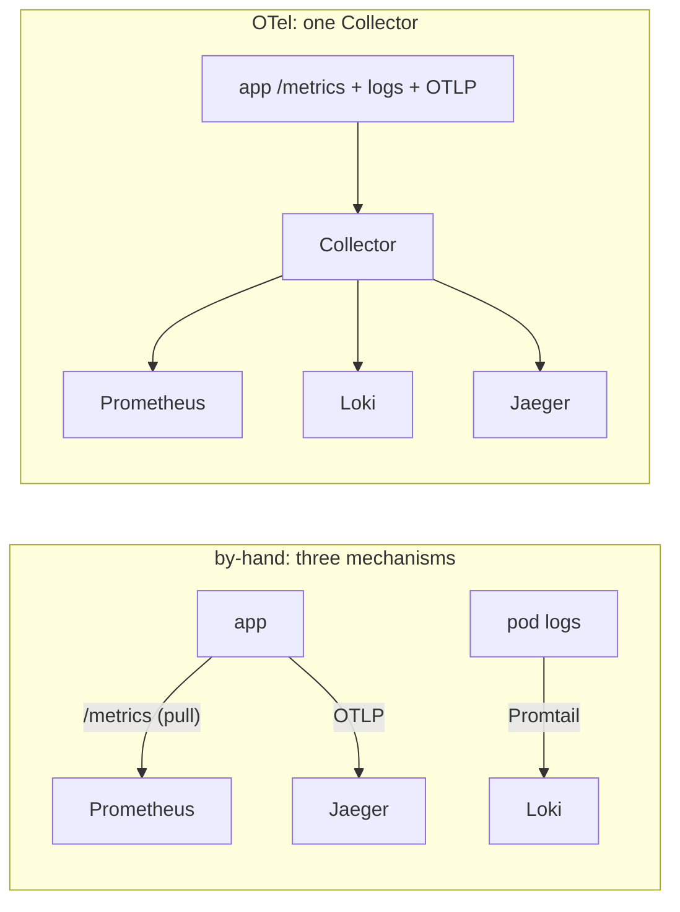

# 07 — Why this vs. the by-hand lab

You have now built the same three pillars two ways. Put them side by side.

| Pillar | By-hand lab (`../`) | This module (OTel Collector) |
|---|---|---|
| **Metrics** | Prometheus **pulls** each pod's `/metrics` | the **Collector** scrapes `/metrics`, **remote-writes** to Prometheus |
| **Logs** | **Promtail** tails pod logs → Loki | the **Collector's `filelog`** tails pod logs → Loki |
| **Traces** | app sends OTLP **straight** to Jaeger | app sends OTLP to the **Collector** → Jaeger |
| **Agents** | Prometheus scraper **+** Promtail **+** app→Jaeger | **one** Collector |
| **Where you change a backend** | three different configs | **one** Collector config |

## What actually moved

Nothing about the *app* changed for metrics and logs — it still exposes `/metrics` and still
writes stdout. What changed is **who collects them**: a single Collector replaced Prometheus's
scraper *and* Promtail, and sits in front of Jaeger for traces. That is the OpenTelemetry
Collector's whole value: **one collection point, one place to change where any signal goes.**

## The honest trade-offs (what this app taught us)

- **Metric names didn't change**, because the Collector scrapes the app's existing
  Prometheus-client metrics. An app that emitted OTel-SDK metrics would get standardised
  **semconv** names instead — vendor-neutral, but different from your old dashboards. Here you
  get the Collector's single-point-of-collection benefit *without* the rename cost.
- **Correlation is only as good as the app's logs.** bankobs logs `correlation_id`, not
  `trace_id`, so trace→logs is **by service + time**, not one-click-by-trace-id ([03](03-logs-with-otel.md)).
  A fully OTel-instrumented app that injects trace context into its logs would get the one-click
  join for free — the Collector doesn't change that; the app's logging does.
- **Graceful apps hide failures.** bankobs absorbs DB outages (and even connection pressure)
  into its cache and handled-4xx, so a database fault does **not** reliably spike the Errors — or
  even the Latency — panel. That's why both drills are **latency** incidents read from the
  **Latency** panel, and why Drill 2 slows a **downstream service dependency** (whose wait the
  caller's trace reveals) rather than the database ([06](06-incident-drills.md)).

## When to reach for the Collector

- You want **one** agent and **one** place to route telemetry, instead of a scraper + a log
  tailer + per-app trace config.
- You want to add processing (sampling, redaction, attributes, batching) in **one** spot for all
  signals.
- You want to swap or add a backend without touching every app.

Run the two labs back to back and the pitch lands: the by-hand lab shows you the three mechanisms;
this one collapses them into one.

— end of the OTEL walkthrough. Back to [00-overview.md](00-overview.md).
